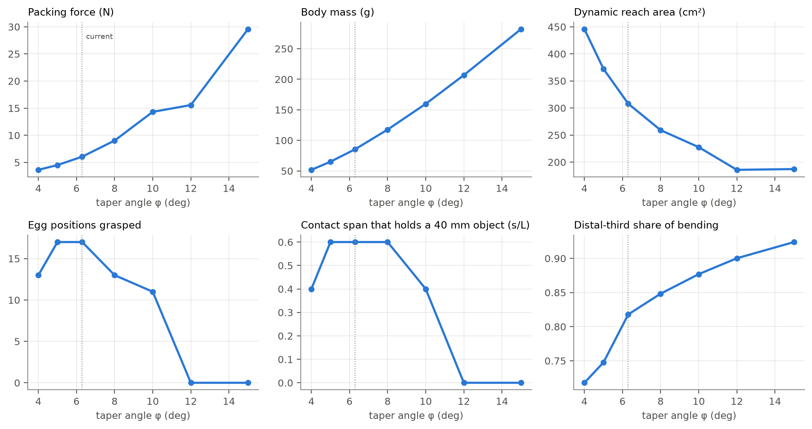

# Taper-selection study for the two-cable SpiRob

**Question.** Which two-cable SpiRob body should be printed for the egg-to-bucket RL task?
The body is fixed by four inputs of this generator: length `L`, tip width `d_tip`,
taper angle `φ` and step `Δθ`. This study keeps the current robot's length and tip width
(`L = 226.28 mm`, `d_tip = 7.14 mm`), uses the paper's `Δθ = 30°`, and changes only the taper:
`φ = 4, 5, 6.3, 8, 10, 12, 15°`. Everything is simulated in MuJoCo with models built by this
repository's `build.py`.

**Answer.** Print **φ = 8°** (base width 38.8 mm, 21 units, about 118 g), with the flexures
sliced at **0.12 mm layers or finer**. Then update the RL model's joint-stiffness profile and
joint limits as described in "What this changes for the RL model" below. The full write-up, with
figures and animations, is the Notion page *"Choosing the SpiRob body — a taper-angle study"*.



## What was simulated

| # | Experiment | What it measures | Module |
|---|---|---|---|
| 1 | One cable pulled slowly | where curling starts, how gradually it spreads, the force to pack | `exp_curl.py` |
| 2 | Tip workspace | the paper's kinematic envelope, the slow-pull path, random dynamic forcing | `exp_workspace.py` |
| 3a | Free cylinder beside the body | largest/smallest diameter wrapped ≥ 180° and held, vs contact point | `exp_grasp.py` |
| 3b | 40 mm egg on a position grid | where the egg can be picked by one cable pull | `exp_grasp.py` |
| 4 | Validation | geometry vs Open-Spiral-Robots, packed shape vs analytic spiral, lock forces vs closed form, joint limits | `exp_validation.py` |
| 5 | Printing and friction | flexure thickness rounded to whole layers; capstan friction on the cable | `exp_print.py` |

Model changes made for the study (in `model.py`, applied to a copy of each generated XML):
gravity off (the rig bends in a horizontal plane), base welded, joint limits `±Δθ`, joint stiffness
`K_i = κ W_i³` with one material constant for all designs, damping `0.05 s × K_i`, and force-controlled
cables.

## Main results

| φ | Packing force | Mass | Wrapped and held (direct pull) | 40 mm egg positions | 45 mm, contact span | Distal share of bending (μ = 0 / 0.3) |
|---|---|---|---|---|---|---|
| 4° | 3.6 N | 52 g | 40–50 mm | 13 | not run | 0.72 / 0.59 |
| 5° | 4.5 N | 65 g | 30–60 mm | 17 | 0.4–0.8 | 0.75 / 0.62 |
| 6.3° | 6.1 N | 86 g | 20–60 mm | 17 | 0.5–0.7 | 0.82 / 0.71 |
| **8°** | **9.0 N** | **118 g** | **20–50 mm** | **13** | **0.3–0.7** | **0.85 / 0.76** |
| 10° | 14.3 N | 160 g | 10–40 mm | 11 | 0.5–0.6 | 0.88 / 0.80 |
| 12° | 15.6 N | 207 g | 10–30 mm | 0 | not run | 0.90 / 0.84 |
| 15° | 29.6 N | 282 g | 10–20 mm | 0 | not run | 0.92 / 0.89 |

* A larger taper curls more strongly from the tip, and keeps doing so under cable friction and
  printing. It also costs force and mass, and shrinks the largest object the body can wrap by a
  direct pull. At this length, 12° and 15° cannot hold the egg at all.
* 8° is the largest taper that still holds a real egg (42–45 mm) over a useful stretch of the body.
* Validation: this repository's geometry matches the authors' design tool to 1e-14 (relative) unit by unit.
  Simulated lock forces follow the closed form `F_i = K_i Δθ / h_i` within a few percent. The packed
  body matches the analytic spiral to sub-millimetre accuracy. One defect was found: the generator
  writes hinge ranges of `±π`, and because MuJoCo ignores parent–child contacts, adjacent units pass
  through each other (up to 1.62 Δθ).

## What this changes for the RL model

1. **Joint limits.** Set each flexible hinge to `±Δθ` (as the paper and the authors' generator do).
   Do not leave it at `±π`.
2. **Stiffness profile.** The spirob-mjlab law `k_i = k₂·0.915^(i−2)` makes the tip about 12× stiffer than
   geometric similarity predicts. The robot then bends almost uniformly (distal share 0.49, against 0.79
   for `K ∝ W³`), and its grasp map changes (Fig. 9). Use `ρ_k = β_g⁻³` as the prior and identify it on
   the new print.
3. **Cables.** With frictionless MuJoCo tendons, the quasi-static shape depends almost only on
   `F₁ − F₀`. The two cables act as one input plus co-contraction. Real cables have friction.
   Measure it; `sim.ramp_single_cable(mu=…)` shows its effect.

## Reproduce

```bash
uv sync --locked
git clone https://github.com/ZhanchiWang/Open-Spiral-Robots ../Open-Spiral-Robots   # validation only
uv run python studies/taper_selection/run_all.py --osr ../Open-Spiral-Robots
```

All results are written to `results/` (JSON is tracked; the large `.npz` logs are not) and figures to
`figures/`. Generated models go to `_build/` (ignored). Rendering uses software EGL; on a desktop it
also works with `MUJOCO_GL=glfw`.

## Limitations

* The joint model is a rigid-link chain with linear springs. TPU hyperelasticity, flexure shear and
  unit deformation are not modelled.
* Absolute stiffness is anchored to spirob-mjlab's `k₂ = 0.183 N·m/rad`, so forces are relative.
  The campaign fit (0.28 N·m/rad) would scale every force by about 1.5×.
* Grasps use a single-cable pull. The paper's reach–wrap strategy depends on cable friction, which
  MuJoCo tendons do not have, so it was not reproduced.
* The 40 mm egg is the spirob-mjlab egg cap, a cylinder in plane. Out-of-plane holding is reported only
  as the normal grip force.

## Licence note

The validation loads two pure geometry functions from a **local clone** of Open-Spiral-Robots at run
time (PolyForm-Noncommercial). It uses the same `ast` method as the authors' own parity tests. No
code from that repository is copied here.
